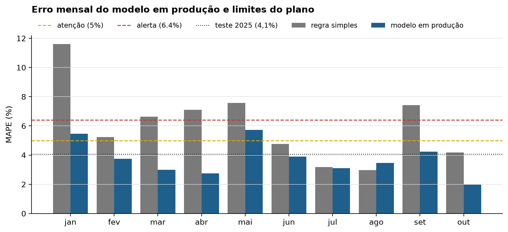
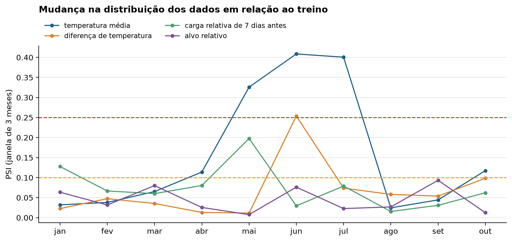
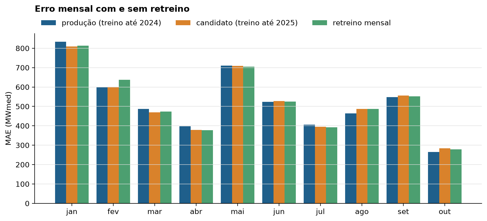

# Plano de monitoramento

Este plano define o que é acompanhado depois que o modelo entra em produção, com que indicador, qual o limite e o que fazer quando o limite é ultrapassado. Os limites ficam em `config/config.yaml` e o script `src/monitorar.py` aplica o plano e gera o relatório.

Cada indicador tem dois limites. Em atenção o indicador é acompanhado de perto no mês seguinte. Em alerta a ação da tabela é executada e registrada.

## Dados

| O que monitorar | Indicador | Atenção | Alerta | Ação | Frequência | Responsável |
|---|---|---|---|---|---|---|
| Valores ausentes | Maior percentual de ausentes entre as variáveis do modelo no mês | acima de 0% | acima de 1% | Identificar a fonte com falha e refazer a integração | Mensal | TI e Dados |
| Dias sem carga | Dias do mês sem valor de carga do ONS | qualquer dia | 2 dias ou mais | Conferir a publicação do ONS e segurar a previsão dos dias afetados | Diária | TI e Dados |
| Qualidade | Valores de carga fora de 3 a 30 mil MWmed ou de temperatura fora de -5 a 40 °C | qualquer valor | 2 valores ou mais | Tratar como erro de medição e abrir incidente | Diária | TI e Dados |
| Mudança de distribuição | PSI dos últimos 3 meses contra os mesmos meses do treino, para temperatura, carga relativa e alvo relativo | acima de 0,10 | acima de 0,25 | Conferir se o erro subiu no mesmo período e avaliar retreino | Mensal | Responsável pelo modelo |
| Atualidade das fontes | Meses desde o último dado de cada fonte | acima de 2 | acima de 4 | Cobrar a publicação e avaliar o impacto no modelo | Mensal | TI e Dados |
| Versão dos dados | Hash do arquivo contra o manifesto | não se aplica | hash diferente | Parar o pipeline até a nova versão ser registrada | A cada execução | TI e Dados |

## Modelo

| O que monitorar | Indicador | Atenção | Alerta | Ação | Frequência | Responsável |
|---|---|---|---|---|---|---|
| Desempenho | MAPE do mês | acima de 5,0% | acima de 6,4% | Investigar os dias de maior erro e avaliar retreino | Mensal | Responsável pelo modelo |
| Degradação | MAE do mês dividido pelo MAE do teste | acima de 1,25 | acima de 1,50 | Comparar com um candidato retreinado e avaliar a troca | Mensal | Responsável pelo modelo |
| Erro sistemático | Viés do mês em % da carga média | acima de 1,5% | acima de 3,0% | Verificar a causa e avaliar retreino | Mensal | Responsável pelo modelo |
| Model drift | Meses seguidos com MAPE ou degradação em alerta | 1 mês | 2 meses | Retreinar e submeter novo candidato à aprovação | Mensal | Responsável pelo modelo |

O limite de alerta do MAPE é o erro da regra simples no teste de 2025. Se o modelo chega a esse nível, ele deixou de valer a pena.

## Negócio

| O que monitorar | Indicador | Atenção | Alerta | Ação | Frequência | Responsável |
|---|---|---|---|---|---|---|
| Benefício | Ganho de MAE sobre a regra simples no mês | abaixo de 20% | abaixo de 10% | Rever se o modelo ainda se justifica | Mensal | Planejamento energético |
| Impacto | Dias do mês em que o modelo subestimou a carga em mais de 5% | acima de 10% | acima de 20% | Avisar o planejamento e usar margem de segurança | Mensal | Planejamento energético |
| Benefício acumulado | Erro evitado em MWh, que é a diferença de MAE para a regra simples vezes 24 horas vezes os dias | sem limite | sem limite | Reportar à diretoria de operações | Trimestral | Planejamento energético |
| Utilização | Semanas em que a previsão foi consultada na programação | abaixo de 90% | abaixo de 70% | Entender por que a previsão não está sendo usada | Trimestral | Planejamento energético |

A utilização não foi medida na simulação porque depende do uso real pela área de planejamento.

## Governança

| O que monitorar | Indicador | Atenção | Alerta | Ação | Frequência | Responsável |
|---|---|---|---|---|---|---|
| Vieses | MAPE de feriados dividido pelo MAPE de dias úteis, e MAPE por estação | acima de 2 | acima de 3 | Revisar as variáveis de feriado e avisar o planejamento | Trimestral | Governança |
| Incidentes | Incidentes abertos em `governanca/incidentes.csv` | 1 ou mais | 3 ou mais | Tratar e registrar a solução | Mensal | Governança |
| Reclamações | Reclamações formais dos usuários da previsão | 1 no trimestre | 3 no trimestre | Analisar a causa e responder ao usuário | Trimestral | Governança |
| Necessidade de revisão | Meses desde o treino ou a última revalidação | acima de 12 | acima de 18 | Treinar candidato com os dados mais recentes e comparar | Mensal | Responsável pelo modelo |
| Documentação | Dias sem revisar o Model Card | acima de 180 | acima de 365 | Revisar o Model Card e a matriz de riscos | Semestral | Governança |

## Decisão de cada mês

| Situação | Decisão |
|---|---|
| Erro em alerta por 2 meses seguidos | Retreinar e submeter novo candidato à aprovação |
| Dados com ausentes, dias faltantes ou valores fora da faixa em alerta | Investigar os dados antes de usar a previsão |
| Indicador de modelo ou de negócio em alerta | Investigar o modelo |
| Drift em alerta com erro em atenção | Investigar o modelo |
| Drift em alerta com erro dentro do limite | Acompanhar |
| Algum indicador em atenção | Manter e acompanhar |
| Tudo dentro do limite | Manter |

Um modelo novo só entra em produção com aprovação registrada, pelo comando `python -m src.promover`. A versão anterior fica guardada no registro para volta rápida.

## Aplicação simulada com os dados de 2026

Os meses de janeiro a outubro de 2026 foram tratados como dados novos, que chegaram depois do treino. O modelo em produção ficou congelado. O relatório completo está em `resultados/monitoramento/relatorio_monitoramento.md`.

| Mês | MAE (MWmed) | MAPE (%) | Ganho sobre a regra simples (%) | Situação | Decisão |
|---|---|---|---|---|---|
| jan/2026 | 834 | 5,46 | 53,0 | Alerta | Investigar o modelo |
| fev/2026 | 599 | 3,75 | 28,4 | Alerta | Investigar o modelo |
| mar/2026 | 487 | 2,98 | 54,9 | Atenção | Manter e acompanhar |
| abr/2026 | 398 | 2,75 | 61,3 | Atenção | Manter e acompanhar |
| mai/2026 | 711 | 5,73 | 24,3 | Alerta | Investigar o modelo |
| jun/2026 | 524 | 3,90 | 18,2 | Alerta | Investigar o modelo |
| jul/2026 | 406 | 3,10 | 2,8 | Alerta | Investigar o modelo |
| ago/2026 | 463 | 3,46 | -16,4 | Alerta | Investigar o modelo |
| set/2026 | 548 | 4,23 | 42,9 | OK | Manter |
| out/2026 | 265 | 1,97 | 52,9 | Atenção | Manter e acompanhar |

O que a simulação mostrou.

- No período o MAE foi de 523 MWmed, melhor que os 555 do teste de 2025, contra 864 da regra simples. O erro evitado somou cerca de 2,5 milhões de MWh em dez meses.
- Nenhum mês teve MAPE em alerta e não houve dois meses seguidos com erro em alerta. O gatilho de retreino não disparou.
- Janeiro ficou em alerta por viés, por subestimação e por degradação, com MAE 1,5 vez o do teste. O modelo subestimou a carga em 39% dos dias, com erro maior na volta do recesso de fim de ano, em 8 e 9 de janeiro. A limitação entrou no Model Card.
- De maio a julho o PSI da temperatura ficou em alerta, com outono e inverno fora do padrão do treino. Em maio o MAPE subiu para 5,73% e depois voltou ao normal.
- Em julho e agosto o modelo ficou no nível da regra simples, e em agosto ficou 16% pior. O indicador de benefício apontou o problema, que o MAPE sozinho não mostraria.
- O candidato treinado com dados até 2025 teve MAE de 521 MWmed e o retreino mensal teve 524, contra 523 do modelo em produção. A diferença fica dentro da tolerância de 1%, então a versão 1 foi mantida e a revalidação foi registrada em `governanca/historico_modelo.csv`.
- A fonte da EPE estava com 10 meses de atraso e a da ANEEL com 3. O modelo em produção não usa a EPE, e a ANEEL só entra na escolha dos dias de treino.

